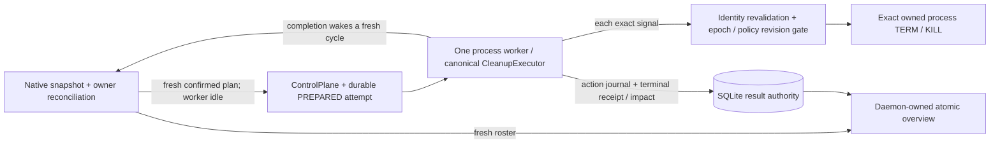
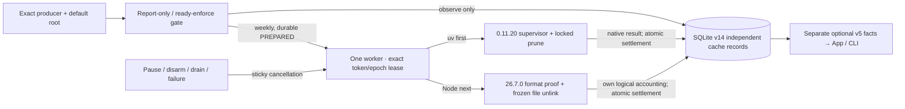

# Architecture / 架构

This view answers one question: **how does a finished browser task, exact Chrome clone residue or rebuildable tool cache become an observed cleanup result, and which component is allowed to act?** It describes current source paths on one macOS user account. Installation transactions and protocol compatibility are explained below rather than mixed into the primary flow.

本图回答：**一个结束的浏览器任务、精确 Chrome clone 残留或可重建工具缓存，如何成为真实清理结果；谁有权执行？** 范围是单个 macOS 用户下的当前源码路径。Chrome clone 与 uv 维护已进入参考安装，Node 编译缓存是 owner 批准的窄例外；各自当前 installed/activated 与实机结果以 current-state 为准。图表示源码权限关系，不表示 multi-day 或广泛环境验证。

Editable source: [architecture.mmd](architecture.mmd). The SVG is a rendered export of that source. Labels use English component names; the Chinese reading guide below follows the same flow. Regenerate with Mermaid using the source's theme; inspect the rendered export after changing it.

## Read the flow / 读图

1. **Lifetime evidence:** `unlinger task run` reserves a durable task, creates a gated command child, and activates its exact PID/birth/UID identity before execution. The issued session binds only verified Playwright CLI controllers. Separately, an optional host adapter may keep an existing ordinary session name while declaring an exact registry selector, live child owner and controller version. The daemon releases either kind only after exact owner absence; an active client, unsupported controller or incomplete proof keeps protection. No release grants signal permission.
2. **Observation and decision:** native snapshots derive executable dev/inode identity from each process's already-mapped Darwin vnode, require its path to match `pidpath`, and never reopen the executable pathname. Exact bundle versions then feed the shared rule sessionizer. Protections, age/stability and durable abandonment checks select eligible process trees. Periodic/process-exit/wake/pressure inputs only request a fresh snapshot; pressure never lowers a gate.
3. **Execution:** report-only records the decision. Enforce mode additionally needs valid signal authority. A frozen plan is revalidated, its signal action is durably PREPARED, then exact controller/root/member TERM and necessary survivor KILL stages run. Absence and bounded revival checks precede terminal settlement.
4. **Visible result:** The source SQLite v14 store adds independent Node cache authority to v13 uv/retired-npm records, v11 clone results, v10 optional host ownership and the earlier attribution/task/impact authorities. One daemon-owned browser overview joins coherent current state, proved process impact, current clone residue and the latest terminal clone-cleanup result; the App only maps that authority into presentation.
5. **Chrome clone storage cleanup:** the exact current-user scanner returns typed shape/size facts plus an in-memory candidate identity set. The storage gate needs the same set at two consecutive 15-minute observations and a complete native snapshot proving no executable/absolute argv path enters a candidate and no cleanup Helper names a matching suffix. Ordinary Chrome/Helpers outside candidates and valid unrelated suffixes do not block; insufficient Chrome-looking facts fail closed. Report-only or any incomplete lifecycle/process/filesystem fact records state without mutation. A healthy ready enforce daemon must persist PREPARED before removing the descriptor-held exact candidates, then immediately rescan and atomically commit the terminal result with the actual latest residue observation. An interrupted or unproved attempt becomes `delivery_unknown`; a later smaller count never retroactively claims success.

中文对应路径：`task run` 可登记真实 command owner；兼容宿主也可通过 optional adapter 提供普通会话的精确 owner lifetime。没有 adapter、版本不支持、owner 仍存活或事实不完整时，controller 会继续受保护。daemon 还要经过完整分类、客户端、profile、冷却和身份条件。report-only 只记录。enforce 还必须获得有效执行权限，先持久化 action，再对精确身份发送信号。最终 receipt 和独立 impact 决定 App 显示的成果，任务结束或一次观察不会增加成绩。Chrome clone 存储路径则要求候选连续两次 15 分钟观察稳定、完整快照证明没有进程通过 executable/绝对 argv 路径引用候选且没有 Helper 指向匹配 suffix；候选外的普通 Chrome/helper 不阻塞。它只在有效 enforce 生命周期中先持久化 PREPARED，再执行 descriptor-relative 删除并立即重扫，随后把 terminal result 与真实 latest observation 原子提交；中断或无法证明的动作只会成为 `delivery_unknown`，不会靠之后更小的目录数倒推成功。

The Chrome clone path is separate from process runtime artifacts and has its own explicit deletion edge. It does not enable any artifact-pack flag or reuse DAP authority. Every runtime-artifact admission flag remains false. The dormant DAP engine is outside the active diagram and retains the unresolved risks in [SAFETY.md](SAFETY.md).

Chrome clone 的磁盘状态单独进入状态库；源码逐个保留 candidate identity，对每个 candidate 独立评估稳定性与 live reference，只删除 scanner 再次确认的 eligible 子集。一份正在使用的 clone 会受保护，但不阻塞其他已稳定且无人引用的 clone。逻辑字节不是保证可释放的 APFS 空间；profile、浏览器数据和 runtime artifact 仍无自动删除入口。历史 generation 34 曾以 healthy `ReadyEnforce` 和 `.app.bundle`-aware per-candidate gate 提供一个 production-timing 实机点，在普通 Chrome 持续开启时移除了八份 stale clone 并保留一份 live clone。

## Ownership and evidence map

| Node / boundary | Canonical implementation |
| --- | --- |
| Command wrapper and activation gate | [CLI task runner](../crates/unlinger-cli/src/task.rs), [task contract](TASKS.md) |
| Task and optional host lifetime/controller binding | [daemon ownership stores](../crates/unlinger-daemon/src/store), [operator IPC](IPC.md#optional-host-session-owner-commands), [rules](../crates/unlinger-rules/src/lib.rs) |
| Exact native identity and snapshots | [macOS adapter](../crates/unlinger-macos/src/lib.rs) |
| Chrome clone scan, stability, process gate and descriptor-relative removal | [macOS storage residue path](../crates/unlinger-macos/src/storage_residue.rs), [daemon lifecycle wiring](../crates/unlinger-daemon/src/main.rs) |
| Classification and protection | [core](../crates/unlinger-core/src/lib.rs), [embedded rule packs](../rules) |
| Frozen plans, revalidation, signals and revival | [core cleanup](../crates/unlinger-core/src), [reconciliation engine](../crates/unlinger-daemon/src) |
| Producer-native uv maintenance | [uv supervisor/adapter](../crates/unlinger-daemon/src/tool_cache.rs), [cache authority](../crates/unlinger-daemon/src/store/tool_cache.rs) |
| Pinned Node compile-cache validation and regular-file removal | [Node adapter](../crates/unlinger-daemon/src/node_compile_cache.rs), [Node safety](SAFETY.md#node-compile-cache-exception) |
| Shared cache scheduling, activity and cancellation | [daemon worker](../crates/unlinger-daemon/src/main.rs), [lifecycle gate](../crates/unlinger-daemon/src/ipc.rs) |
| Durable SQLite state and impact | [history store](../crates/unlinger-daemon/src/store.rs) |
| Atomic browser projection and ordinary commands | [protocol](../crates/unlinger-protocol/src/lib.rs), [public IPC](../crates/unlinger-daemon/src/public_ipc.rs) |
| App presentation only | [browser mapper](../apps/UnlingerApp/Sources/UnlingerKit/State/BrowserOverviewMapper.swift), [history mapper](../apps/UnlingerApp/Sources/UnlingerKit/State/BrowserHistoryMapper.swift) |
| Installed lifecycle | [service CLI](../crates/unlinger-cli/src/service.rs), [operator runbook](INSTALLED_DOGFOOD.md) |

Native path decoding follows [Apple's libproc implementation](https://github.com/apple-oss-distributions/xnu/blob/main/libsyscall/wrappers/libproc/libproc.c),
which returns the pathname byte count without its NUL terminator. Source checks
that complete absolute path before matching its mapped vnode. Path-free coverage
counters distinguish unavailable paths, zero return without errno and unproved
mapped vnodes; these diagnostics do not create identity or cleanup authority.

## Continuous observation during process cleanup / 清理期间持续观测

The long-running daemon uses one process-cleanup worker. The observation owner
continues native snapshots, exact task/host-owner reconciliation, cooling,
protection and roster publication while the worker waits for TERM/KILL grace
and revival checks. It dispatches only a fresh confirmed plan when that worker
is idle; it neither queues old plans nor starts a second process attempt.
The ordinary two-observation gap remains in the observation cycle.

The worker uses the same execution and terminal-settlement routine as one-shot
and direct synchronous engine callers. It holds no lifecycle lock across grace
or revival waits. Every signal still needs the frozen enforcement epoch and
cleanup-policy revision. Pause followed immediately by Resume cannot revive
the old plan. Observation failure, Disarm, Drain and terminal failure close the
same delivery gate. Worker completion requests another fresh cycle through the
existing bounded scheduler wait, including when native event hints are unavailable.

Process activity belongs to the exact attempt rather than the scan that launched
it. A replacement scan cannot clear it or turn an empty roster into a completed
cleanup. Successful terminal settlement updates durable receipt/impact once;
only the joined worker can be recovered as uncertain after failure or panic.
Shutdown cancels and joins this exact worker; engine destruction never detaches
it. The existing process-only artifact policy and single open attempt remain.

长期 daemon 的 process cleanup 与观测各有 owner；新的 native snapshot、owner
退出、保护和 roster 更新不再等待整段 signal grace 与 revival。只有 fresh confirmed
plan 能在 worker 空闲时进入 PREPARED，没有后台队列，也没有并发 process attempts。
暂停、撤权或失败仍在每次 signal 前生效，快速 Resume 不复活旧 plan。worker 的
terminal receipt 是结果 authority；新的空快照不能替它提前宣布成功。当前安装与
实机证据仍由 [current-state](current-state.md) 单独维护。

## Durable boundaries

Each `HistoryStore` and its clones share **one active SQLite connection behind a
mutex**. A short store operation owns that connection until its statements or
transaction finish; native observation, signals and grace/revival waits run
outside that ownership. This removes competing in-process SQLite writers while
retaining independent operation transactions, `synchronous=FULL`, WAL and the
original two-second bound for an external writer. There is no mutation replay,
connection pool or automatic rehabilitation of terminal Failed.

Every operation still validates the database and sidecars. On Unix it also
requires the original database device/inode: retaining a live handle must not
follow a replacement pathname or keep operating after its canonical file was
removed. Nested store queries explicitly release their guard first. The final
clone releases SQLite's connection and WAL lifetime; normal checkpoints remain
available. Backup/rollback continues to require a SQLite-consistent snapshot and
an exact drained-instance boundary. Configuration errors retain the live handle's
nonzero [`sqlite3_system_errno`](https://www.sqlite.org/c3ref/system_errno.html)
when available; primary/extended code and source basename/line remain path-free.

This boundary follows an actual generation-49 field failure: action PREPARED
could not obtain `BEGIN IMMEDIATE` and returned `SQLITE_BUSY`. The old idle-WAL
keeper reduced sidecar churn but left independent operation connections competing
for writes. Source/installed/field repair evidence stays separate in
[current state](current-state.md).

源码以一个明确的 connection owner 串行化短数据库操作；各自 transaction 仍独立，
不会跨 native 调用、signal 或长等待持锁。路径和原始文件 identity 每次重验；外部
writer 仍受原有 SQLite timeout 约束，I/O/unknown delivery 仍 fail closed。旧 migration
梯子已移除，新库直接创建 v14，已有 v14 的数据与历史 provenance 保留。

The owner-private Unix socket serves only frontend schema v5 and operator v1; retired v2/v3/v4 and unknown versions are rejected before dispatch. The App emits v5 only and cannot encode lifecycle operations. Ordinary mutations are journalled before send and reconciled after uncertain delivery without automatic resend. The daemon commits mutation state and receipt atomically. Each IPC request makes one bounded attempt.

Raw arguments, executable/profile paths and frozen signal targets stay transient. Public persistence and UI use typed redacted records. Task and host-session capabilities remain private operator authority, excluded from ordinary App DTOs and diagnostic exports. There is no normal-operation network service. See [IPC](IPC.md) and [privacy](PRIVACY.md) for exact schema and data boundaries.

## Tool-cache lanes / 工具缓存维护路径

Tool-cache maintenance is separate from the browser and Chrome paths above.
Source SQLite v14 keeps independent Node and uv latest-attempt authority, plus
retired npm evidence.
A single cache worker runs independently of process observation; exact activity
owners project lifecycle quiescence and preserve sticky cancellation.
Discovery queries share one bounded, read-only exact-child path. A missing
producer/default bucket is absent; timeout, unsuccessful execution, malformed
output or changed binding is unavailable. Unsupported requires a successfully
proved unadmitted version/format. The existing daemon log records a path-free
reason for unavailable observations; no extra persisted status machine is added.

生产工具按自己的引用与保留规则回收缓存；已授权范围包括 uv 自己的缓存环境，
不包括项目 `.venv` 或用户成果。原生锁忙碌时延后，暂停请求绑定到具体 attempt，
快速恢复也不能取消旧 child 的停止请求。App 不重算删除资格。
uv 与 Node 结果都不加入浏览器 cleanup impact；当前安装与实机观察由
[current-state](current-state.md) 分别记录。Node 不依赖原生 prune：它只处理精确
版本/default bucket 中经过 header、长度、CRC 与冻结身份验证的普通文件，不移除
目录。未知内容或新发布的 final file 阻止 frozen plan；安全的原生临时文件保留在
计划之外，其他 bucket 与自定义位置继续受保护。精确
lease 在每个文件前重查；快速 Resume 不会复活被取消的动作。成功 unlink 数和
已验证逻辑长度估算分别记账，不宣称抵抗 hostile same-UID 或 inode-atomic unlink。
